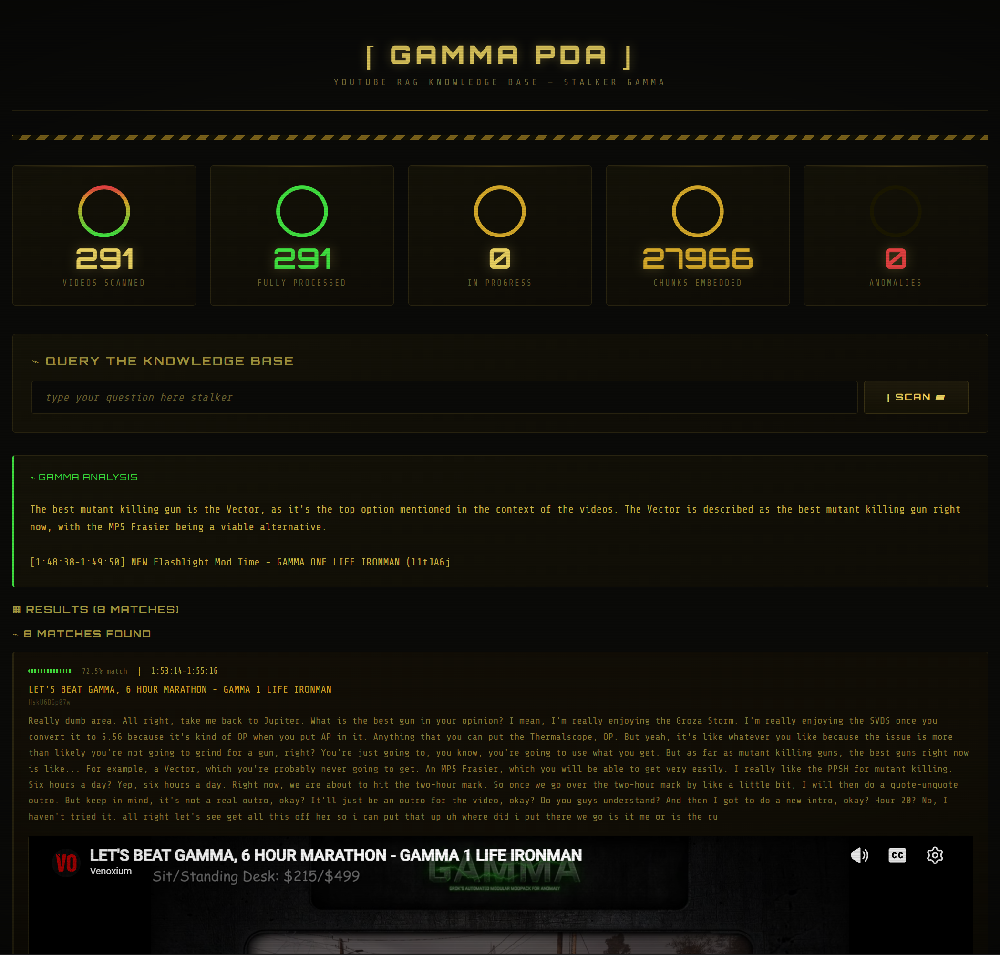

# ⌈ Ask Veno ⌋

## Stalker Gamma PDA — Local Multi-Corpus RAG Dashboard

A fully offline FastAPI dashboard combining two knowledge sources behind one S.T.A.L.K.E.R. Gamma PDA interface:

1. **Veno Archive** — the Venoxium livestream transcript corpus (YouTube → Whisper → ChromaDB).
2. **GAMMA 0.9.5 Database** — the authoritative structured item corpus, synchronized from the [stalker-anomaly-gamma-db](https://github.com/simonwdev/stalker-anomaly-gamma-db) project.

**No cloud APIs. No paid services. Just ChromaDB + SQLite FTS5 + Ollama + FastAPI running on your own hardware.**

---

### ✦ What it does

```
                         User query  (AUTO / VENO / GAMMA 0.9.5 / COMBINED)
                              │
                       deterministic router
                    ┌─────────┴──────────┐
             Veno transcript corpus   GAMMA 0.9.5 item corpus
             dense (E5) + BM25        exact alias lookup + SQLite facts
                    │                 + dense (E5) + BM25
                    └────── RRF fusion ──────┘
                              │
                 optional cross-encoder rerank
                              │
             weak evidence? → one rewrite + one retry (max 1)
                              │
                 qwen3:0.6b answer with labeled sources
                 [GAMMA 0.9.5 DATABASE] vs [VENOXIUM TRANSCRIPT]
```

Ask any question. AUTO routing sends item/stat questions to the GAMMA database, stream questions to the transcript archive, and mixed questions to both — with evidence cards that always say which source said what.

---

### ✦ Screenshots

#### Home Dashboard



Full dashboard with the Stalker Gamma PDA aesthetic — amber phosphor glow, CRT scanlines, circular progress stats, interactive search bar, and the video archive table.

---

### ✦ Architecture

```
┌─────────────────┐     ┌────────────────────────┐     ┌───────────────┐     ┌──────────────┐
│                 │     │ ChromaDB               │     │               │     │              │
│  FastAPI UI     │────▶│  youtube_chunks        │────▶│ multilingual- │────▶│  Ollama      │
│  (Stalker PDA   │     │  (299 videos, 28,692   │     │ e5-large      │     │  qwen3:0.6b  │
│   "Gamma"       │     │   chunks)              │     │ embeddings    │     │  (on CPU)    │
│   Theme)        │     │  gamma_items_095_*     │     │ (on CPU)      │     │              │
│                 │     │  (1,786 items, 7,362   │     └───────────────┘     └──────────────┘
└─────────────────┘     │   facets)              │
        │               └────────────────────────┘
        │               ┌────────────────────────┐
        └──────────────▶│ SQLite                 │  exact item/alias lookup,
                        │  gamma_095.sqlite      │  structured facts, and
                        │  lexical_search.sqlite │  BM25 (FTS5) retrieval
                        └────────────────────────┘
```

| Layer | Technology |
|-------|------|
| Dashboard | FastAPI + custom template engine (modular `app/`, `rag/`, `storage/`, `indexing/`, `presentation/` packages) |
| Vector DB | ChromaDB (persisted; separate transcript + versioned GAMMA collections) |
| Structured DB | SQLite — canonical GAMMA 0.9.5 items/aliases/relations + FTS5 BM25 indexes |
| Retrieval | exact alias lookup → dense (E5) + BM25 → Reciprocal Rank Fusion → optional cross-encoder |
| Embeddings | intfloat/multilingual-e5-large (CPU) |
| LLM | ollama qwen3:0.6b (CPU) — labeled multi-corpus prompting, one corrective retry |
| Audio | yt-dlp + Whisper (CUDA on GPU 0 — RTX A6000) |
| State | SQLite registries |
| Deployment | conda env + uvicorn |

**Hardware:**
- GPU 0: NVIDIA RTX A6000 (49GB) — Whisper transcription only
- CPU: AMD Ryzen 9 9950X — embedding model, Ollama inference, web app

---

### ✦ Development architecture

The web application is split into small modules; startup commands, endpoints, and the UI are unchanged.

```
web_app.py                    Compatibility entrypoint — `python web_app.py` / `uvicorn web_app:app`
app/
  config.py                   Paths, collections, GAMMA 0.9.5 pin, hybrid-retrieval constants
  main.py                     FastAPI instance + route registration
  routes.py                   Thin HTTP handlers: /, /search, /api/stats, /api/videos, /api/search
rag/
  embeddings.py               Lazy CPU-only E5 model singleton (shared by both corpora)
  transcript_retriever.py     Legacy dense retrieval (unchanged) + hybrid dense/BM25 variant
  gamma_retriever.py          GAMMA: exact alias lookup → structured facets → BM25+dense+RRF
  evidence.py                 Common evidence model across corpora
  fusion.py                   Reciprocal Rank Fusion + FTS MATCH sanitization
  router.py                   Deterministic AUTO-mode corpus routing
  reranker.py                 Optional lazy cross-encoder (fail-open)
  query_rewriter.py           One-shot Ollama rewrite for weak retrievals
  generator.py                Ollama synthesis: legacy + labeled multi-corpus prompts
  pipeline.py                 Modes auto/veno/gamma/combined, one corrective retry
storage/
  archive.py                  Read-only SQLite video stats and records
  gamma.py                    Canonical GAMMA 0.9.5 schema + read layer (.state/gamma_095.sqlite)
  lexical.py                  Transcript BM25 index (.state/lexical_search.sqlite)
indexing/gamma/               Deterministic loader/normalize/builder/facets for the GAMMA corpus
scripts/
  sync_gamma_095.py           Sparse sibling checkout of the upstream dataset (pinned 0.9.5)
  build_gamma_095.py          Staged, atomic corpus build (SQLite + versioned Chroma collection)
  build_lexical_index.py      Transcript FTS5 rebuild from existing Chroma docs
  daily_gamma_job.py          Locked daily sync + conditional rebuild
  daily_all_job.py            GAMMA job → existing YouTube job → lexical sync
evaluation/                   Gold dataset + deterministic metrics + ablation runner
presentation/
  formatters.py               Pure formatting/sanitization helpers
  template_engine.py          Custom {{placeholder}} renderer + template loading
  renderer.py                 Server-side HTML construction (+ corpus selector, GAMMA cards)
  templates/page.html         The full PDA page (HTML/CSS/JS)
tests/                        Suite: python -m unittest discover -s tests
docs/gamma-095-data-model.md  Verified upstream data-model discovery notes
```

---

### ✦ GAMMA 0.9.5 corpus

The structured item corpus is synchronized from the upstream
**[stalker-anomaly-gamma-db](https://github.com/simonwdev/stalker-anomaly-gamma-db)** project
(© its authors, licensed **AGPL-3.0**) — specifically the generated
`site/public/data/gamma-0.9.5` dataset, checked out sparsely into a sibling
directory (`../stalker-anomaly-gamma-db-upstream`) and transformed locally
into `.state/gamma_095.sqlite` + a versioned Chroma collection. No upstream
application code is copied into this repository; provenance (upstream commit,
manifest SHA-256, source files per record) is retained end-to-end. Ingestion
is hard-pinned to pack `gamma-0.9.5`.

```bash
python scripts/sync_gamma_095.py       # clone/update the upstream dataset (fast-forward only)
python scripts/build_gamma_095.py      # staged build; no-op while manifest is unchanged
python scripts/build_lexical_index.py  # transcript BM25 index from existing Chroma docs
python evaluation/run_evaluation.py    # routing + retrieval evaluation against gold data
```

### ✦ Daily maintenance & systemd

`scripts/daily_all_job.py` chains the GAMMA job, the existing YouTube job,
and the lexical sync. To migrate the existing systemd user timer, edit the
service unit (e.g. `~/.config/systemd/user/daily-rag.service`) and change
only the ExecStart line:

```ini
# before
ExecStart=/path/to/env/bin/python scripts/daily_channel_job.py
# after
ExecStart=/path/to/env/bin/python scripts/daily_all_job.py
```

then `systemctl --user daemon-reload`. Nothing in this repository modifies
systemd automatically. An unchanged upstream manifest costs one git fetch —
embeddings are only rebuilt when GAMMA 0.9.5 data actually changes, and a
failed rebuild always leaves the previous corpus active.

---

### ✦ Setup

```bash
# Clone & enter
git clone https://github.com/cbroker1/ask-veno.git
cd ask-veno

# Environment
conda env create -f environment.yml
conda activate ask-veno

# Ollama models needed
ollama pull qwen3:0.6b

# Build the GAMMA 0.9.5 corpus (sparse upstream checkout + canonical DB + embeddings)
python scripts/sync_gamma_095.py
python scripts/build_gamma_095.py

# Build the transcript BM25 index (from the existing Chroma docs)
python scripts/build_lexical_index.py

# Start the dashboard
python web_app.py
```

Then open `http://localhost:9876` in your browser. (The app degrades
gracefully: without the GAMMA corpus it runs transcript-only, exactly as
before.)

---

### ✦ Quick Start

1. **Browse** — The video archive table shows all ingested videos with status, chunk count, duration, and upload date.
2. **Pick a source** — AUTO (routed for you), VENO (stream archive), GAMMA 0.9.5 (item database), or COMBINED.
3. **Search** — Type any question in the search bar and hit Enter (or click SCAN).
4. **Read** — The field report above the results gives you a direct, locally-generated answer that says which facts came from the database and which from the stream.
5. **Deep-link** — Click any stream-evidence card to expand inline video playback at the exact timestamp; GAMMA cards show the item's canonical record and provenance.

---

### ✦ Key UI Details

- **Phosphor glow** — Each text element has a subtle `text-shadow` glow mimicking CRT phosphor excitation
- **Scanlines** — CSS `linear-gradient` on a pseudo-element overlay creates horizontal scanline effect
- **Corpus selector** — Radio-chip SOURCE row (AUTO / VENO / GAMMA 0.9.5 / COMBINED) with native keyboard behavior
- **Dual evidence cards** — amber Veno stream cards with inline playback; blue GAMMA database cards with item, category, facet type, EXACT MATCH badge, and provenance
- **Progress rings** — Circular SVG/progress elements show pipeline completion at a glance
- **Interactive cards** — Hover triggers amber glow transition; click expands inline video player
- **Loading state** — Spinning nuclear ☢ loader during Ollama inference with fade-out on completion
- **Responsive layout** — Grid-based stat panels collapse gracefully on narrower viewports
- **No external fonts loaded at runtime** — Orbitron loaded once, then system fallbacks

---

### ✦ Pipeline Stats (current run)

| Metric | Value |
|-------|--------|
| Videos ingested | 299 |
| Transcript chunks | 28,692 (dense + BM25 indexed) |
| GAMMA 0.9.5 items | 1,786 (100% of upstream index; 6,880 aliases, 57,768 relations) |
| GAMMA retrieval facets | 7,362 (dense + BM25 indexed) |
| Processing status | 100% complete |
| Anomalies | 0 |
| Routing accuracy (64-question gold set) | 64/64 |
| Retrieval p50 (full adaptive pipeline) | ~110 ms |
| Embedding model | `intfloat/multilingual-e5-large` (CPU) |
| Inference model | `qwen3:0.6b` (local Ollama, CPU) |

---

### ✦ License

Private / personal project. All rights reserved.

GAMMA 0.9.5 item data is synchronized at build time from the
[stalker-anomaly-gamma-db](https://github.com/simonwdev/stalker-anomaly-gamma-db)
project (AGPL-3.0); see “GAMMA 0.9.5 corpus” above for attribution and
provenance details.

---

*Designed with the Gamma PDA — because the best RAG interface is one that feels like it survived the Zone.*
